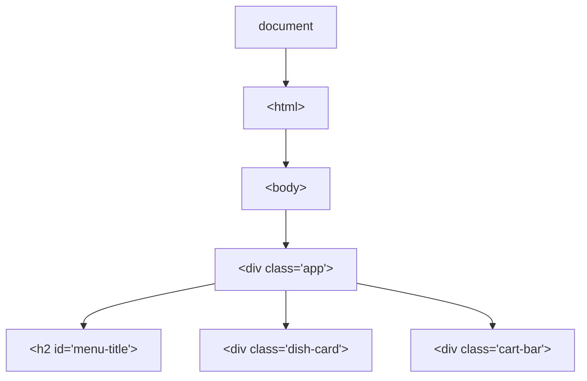

<h1 style="max-width:70%">Information & Communication Architecture — Lab 9 — DOM Manipulation & Interactive Events</h1>

---
layout: people
title: Contacts
---

<PersonCard role="Course Instructor" name="Dr. Nourhan Hamdi" email="nourhan.hamdi@giu-uni.de" room="M2.312" />
<PersonCard role="Teaching Assistant" name="Mr. Nour Gaser" email="nour.aly@giu-uni.de" room="M2.419" />
<PersonCard role="Teaching Assistant" name="Ms. Menna Khalid" email="mennatallah.khaled@giu-uni.de" room="M2.437" />
<PersonCard role="Teaching Assistant" name="Ms. Shorouk Salah" email="shorouk.metwally@giu-uni.de" room="M2.437" />
<PersonCard role="Teaching Assistant" name="Mr. Mahmoud" email="mahmoud.amer@giu-uni.de" room="M2.506" />
<PersonCard role="Teaching Assistant" name="Mr. Younes Zied" email="younes.zied@giu-uni.de" room="M2.506" />

---
layout: media
image: /img/illustrations/hourglass.png
side: left
alt: An hourglass
dense: true
---

# Lab agenda

| Duration | Topic |
|---|---|
| 10 min | **1. What Is the DOM?** How the browser turns HTML tags into a live tree of JavaScript objects |
| 10 min | **2. Selecting Elements:** `getElementById()`, `querySelector()`, and `querySelectorAll()` |
| 10 min | **3. Changing the Page:** Updating `.textContent`, `.style`, and `.classList` |
| 10 min | **4. User Events:** Listening for button clicks with `.addEventListener("click", ...)` |
| 25 min | **5. Walkthrough & Activity:** Build the interactive **Burger Republic Cart** (`ica-lab-09`) & push to <Tool name="github" /> |

---
layout: section
icon: intro
sub: Moving JavaScript out of the hidden Console and onto the visible webpage
---

# 01 — What Is the DOM?

---
layout: split
title: The Document Object Model (DOM)
dense: true
---

In **Lab 8**, JavaScript printed to the hidden **DevTools Console**. Real users expect the **webpage itself** to update when they click a button.

- **DOM (Document Object Model):** When a browser loads `index.html`, it turns every HTML tag into a live **JavaScript object (node)** in a tree.
- JavaScript accesses this tree via **`document`** to read or change elements without reloading the page.
- **Parent / Child / Siblings:** `<div class="app">` is the **parent** of `<h2>` and `.cart-bar`; those two children are **siblings**.

::right::



---
layout: section
icon: code
sub: Reaching into the DOM tree from JavaScript to grab specific HTML elements
---

# 02 — Selecting DOM Elements

---
layout: split
title: Three methods to select elements
dense: true
---

Before JavaScript can change an element on screen, it must **select** it from `document`:

| Method | Input | Returns |
|---|---|---|
| **`getElementById("id")`** | ID name (**no `#`**) | Single element (or `null`) |
| **`querySelector("css")`** | CSS selector (`#id`, `.cls`) | **First** match (or `null`) |
| **`querySelectorAll("css")`** | CSS selector (`.cls`) | **`NodeList`** of all matches |

<div class="giu-refs__note"><code>getElementById("menu-title")</code> takes the ID <strong>without</strong> <code>#</code>; <code>querySelector("#menu-title")</code> uses CSS syntax <strong>with</strong> <code>#</code> or <code>.</code>!</div>

::right::

<FileTag name="dom-concepts.js (selectors)" />

<<< @/snippets/lab-09/dom-concepts.js#selectors

---
layout: section
icon: code
sub: Updating visible text, inline styles, and CSS classes from JavaScript
---

# 03 — Changing Content & Styles

---
layout: split
title: Updating textContent, style & classList
dense: true
---

Once you select an element (`const promoMsg = document.getElementById("promo-msg")`), you can update it live:

| Property / Method | Effect on `<p id="promo-msg">` |
|---|---|
| **`.textContent = "..."`** | Replaces the visible text inside the tag |
| **`.style.color = "..."`** | Sets an inline CSS property on the element |
| **`.classList.add("...")`** | Adds a class rule from `style.css` (`.remove`, `.toggle`) |

::right::

<FileTag name="dom-concepts.js (modifying elements)" />

<<< @/snippets/lab-09/dom-concepts.js#modify

---
layout: section
icon: code
sub: Running JavaScript functions when a user clicks a button or types in an input
---

# 04 — Listening for User Events

---
layout: split
title: Event listeners (addEventListener)
dense: true
---

Websites are **event-driven**: JavaScript waits for the user to do something (click a button, type in a search bar) and then runs a **callback function**.

```js
element.addEventListener("click", () => {
  // Runs every time the user clicks element
});
```

- **Argument 1 (`"click"`):** The event type to listen for (`"click"`, `"input"`, `"submit"`).
- **Argument 2 (`() => { ... }`):** The function that runs when the event happens.

::right::

<FileTag name="dom-concepts.js (click event)" />

<<< @/snippets/lab-09/dom-concepts.js#events

<div class="giu-refs__note">State pattern: keep the number in a JavaScript variable (<code>let count = 0</code>), update the variable first (<code>count = count + 1</code>), and then copy the new value into the DOM (<code>countEl.textContent = count</code>).</div>

---
layout: section
icon: activity
sub: Step-by-step build of the Burger Republic Interactive Cart in VS Code
---

# 05 — Code Walkthrough: ica-lab-09

---
layout: split
title: "The plan: 3 files in 4 steps"
dense: true
---

Create a new folder named **`ica-lab-09`** and open it in <Tool name="vscode" /> (**File → Open Folder...**):

1. **Step 1 (`style.css`)** — Style the mobile container, dish rows, buttons, cart bar, and `.applied` class.
2. **Step 2 (`index.html`)** — Build the Burger Republic menu with `id` attributes on every interactive element and `<script src="script.js"></script>` at the bottom.
3. **Step 3 (`script.js` top)** — Select the DOM elements and declare the cart state variables (`itemCount`, `totalPrice`).
4. **Step 4 (`script.js` bottom)** — Wire `.addEventListener("click", ...)` on the **+ Add** and **Promo** buttons.

::right::

<div class="p-3 rounded-xl border border-slate-200 bg-slate-50 font-mono text-xs space-y-2">
  <div class="font-bold text-slate-900">ica-lab-09/</div>
  <div class="pl-4 space-y-1.5 text-[0.72rem]">
    <div class="flex items-center justify-between p-1.5 rounded bg-white border border-teal-200">
      <span class="font-bold text-teal-800">├── style.css</span>
      <span class="font-sans text-[0.62rem] text-slate-600">Step 1 — Card &amp; cart styles</span>
    </div>
    <div class="flex items-center justify-between p-1.5 rounded bg-white border border-blue-200">
      <span class="font-bold text-blue-800">├── index.html</span>
      <span class="font-sans text-[0.62rem] text-slate-600">Step 2 — HTML with <code>id="..."</code></span>
    </div>
    <div class="flex items-center justify-between p-1.5 rounded bg-white border border-amber-200">
      <span class="font-bold text-amber-800">└── script.js</span>
      <span class="font-sans text-[0.62rem] text-slate-600">Steps 3–4 — DOM &amp; click events</span>
    </div>
  </div>
</div>

---
layout: split
title: "Step 1 of 4: style.css"
dense: true
class: giu-small
---

1. In <Tool name="vscode" /> Explorer (`ICA-LAB-09`), click **New File** and name it `style.css`.
2. Add the styles on the right and press `Ctrl + S` to **save**.
3. Line 23 defines **`.applied { color: #0d9488; font-weight: bold; }`**—our JavaScript will attach this class when the user clicks the promo button!

::right::

<FileTag name="style.css" state="new" />

<<< @/snippets/lab-09/style.css {23}

---
layout: split
title: "Step 2 of 4: index.html with IDs & script tag"
wideRight: true
dense: true
class: giu-small
---

1. Create `index.html` next to `style.css` and press `Ctrl + S` to **save**.
2. Notice the **5 IDs** that give JavaScript hooks into the page:
   - Buttons: `id="add-bestie"`, `id="promo-btn"`
   - Display tags: `id="promo-msg"`, `id="cart-count"`, `id="cart-total"`
3. Line 18 loads `<script src="script.js"></script>` **after** the HTML elements so every ID exists in the DOM when `script.js` runs.

::right::

<FileTag name="index.html" state="new" />

<<< @/snippets/lab-09/index.html {9,11-12,14-15,18}

---
layout: split
title: "Step 3 of 4: select elements & state (script.js top)"
dense: true
class: giu-small
---

1. Create `script.js` next to `index.html`.
2. Add the **top half** of `script.js` shown on the right and press `Ctrl + S`:
   - Lines 3–12 grab the display elements and buttons using `document.getElementById(...)`.
   - Lines 15–17 initialize our cart state (`itemCount = 0`, `totalPrice = 0`, `promoApplied = false`).

::right::

<FileTag name="script.js (top)" state="new" />

<<< @/snippets/lab-09/script.js#select {3-12,15-17}

---
layout: split
title: "Step 4 of 4: wire click listeners (script.js bottom)"
dense: true
class: giu-small
---

1. At the **bottom** of `script.js`, add `updateCartUI()` and the two `.addEventListener("click", ...)` blocks on the right.
2. Press `Ctrl + S` to **save** and open `index.html` with **Live Server**.

::right::

<FileTag name="script.js (bottom)" state="edit" />

<<< @/snippets/lab-09/script.js#events {1-4,6-10,12-20}

---
layout: split
title: "Checkpoint: test the interactive cart in the browser"
wideRight: true
dense: true
---

<Activity label="Predict & click in sequence">

Open `index.html` in your browser and perform these 3 clicks in order—confirm the page updates immediately **without refreshing**:

1. Click **+ Add** next to *Bestie Deal (EGP 600)*.
2. Click **EGP 50 Off**.
3. Click **EGP 50 Off** a **second time**—why doesn't the price drop again? *(Look at `!promoApplied` on line 33!)*

</Activity>

Nothing happens when you click? Jump to <Link to="fix-dom">**DOM & Event errors**</Link> in Troubleshooting.

::right::

| User Action | `#cart-count` | `#cart-total` | `#promo-msg` |
|---|---|---|---|
| **Page loads** | `0` | `0` | `Have a Talabat Pro promo?` |
| **1. Click Bestie (+600)** | `1` | `600` | `Have a Talabat Pro promo?` |
| **2. Click EGP 50 Off** | `1` | `550` | **`EGP 50 off!`** *(teal)* |
| **3. Click EGP 50 Off again** | `1` | `550` | Guarded by `!promoApplied` |

---
layout: activity
title: "In-Lab Activity: Add a 2nd Dish & Clear Cart Button"
label: "20-minute hands-on practice"
dense: true
---

Extend your `ica-lab-09` project with two new interactive features, test them in the browser, and push to <Tool name="github" />:

1. **Add a 2nd dish (`id="add-ranch"`):** In `index.html`, add a `.dish-card` for **`Mushroom Ranch (EGP 250)`** with `<button id="add-ranch" class="btn">+ Add</button>`. In `script.js`, select `#add-ranch` and add a `"click"` listener that increments `itemCount` by `1`, adds `250` to `totalPrice`, and calls `updateCartUI()`.
2. **Add a "Clear Cart" button (`id="clear-btn"`):** In `index.html`, add `<button id="clear-btn" class="btn">Clear Cart</button>`. In `script.js`, listen for `"click"` on `#clear-btn` to reset `itemCount = 0`, `totalPrice = 0`, `promoApplied = false`, reset `promoMsg.textContent = "Have a Talabat Pro promo?"`, call `promoMsg.classList.remove("applied")`, and call `updateCartUI()`.
3. **Commit & push to GitHub:** Run `git init`, `git add .`, `git commit -m "Complete Lab 9 DOM cart"`, and push to a public repository named **`ica-lab-09`**.

---
layout: section
icon: tools
sub: Fixing null element errors and unresponsive buttons
---

# Troubleshooting

---
layout: default
routeAlias: fix-dom
class: giu-fix
dense: true
---

# DOM & Event errors

| Symptom / Exact Console error | Cause & fix |
|---|---|
| `Uncaught TypeError: Cannot set properties of null (setting 'textContent')` | `getElementById(...)` returned `null` because the ID string in `script.js` does not match `id="..."` in `index.html` (or you wrote `"#cart-count"` with a `#` inside `getElementById`). |
| `Uncaught TypeError: Cannot read properties of null (reading 'addEventListener')` | 1. Typo in the button's `id` in `index.html` or `script.js`.<br>2. Or `<script src="script.js"></script>` was placed in `<head>` before the buttons existed—move it right above `</body>`. |
| Button click does nothing and Console shows no errors | Make sure you saved **both** `index.html` and `script.js` (`Ctrl+S`), and check that you wrote `addEventListener("click", ...)` (all lowercase `"click"`). |

---
layout: refs
title: References & useful links
dense: true
---

## DOM Manipulation & Events (MDN)

- [MDN — Introduction to the DOM](https://developer.mozilla.org/en-US/docs/Web/API/Document_Object_Model/Introduction) — how HTML becomes a tree of nodes
- [MDN — Document.getElementById()](https://developer.mozilla.org/en-US/docs/Web/API/Document/getElementById) & [Document.querySelector()](https://developer.mozilla.org/en-US/docs/Web/API/Document/querySelector)
- [MDN — EventTarget.addEventListener()](https://developer.mozilla.org/en-US/docs/Web/API/EventTarget/addEventListener) — listening for `"click"` and `"input"` events
- [MDN — Element.classList](https://developer.mozilla.org/en-US/docs/Web/API/Element/classList) — `.add()`, `.remove()`, and `.toggle()`

<div class="giu-refs__note">The DOM concepts and code patterns in this deck are directly included in the Final Exam and form the display layer for Lab 10's live API fetch!</div>

---
layout: end
image: /img/illustrations/thank-you.png
sub: Open floor for questions — see you in Lab 10 for APIs, JSON/XML & Course Project PD3 Integration!
---

# Questions?
